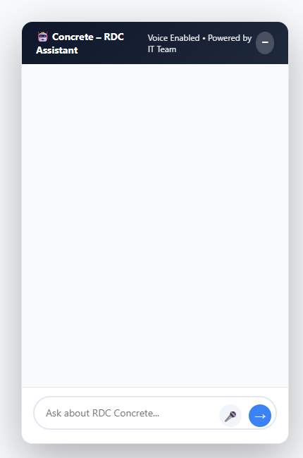

# RDC Website Chatbot

A multilingual, voice-enabled AI assistant for a company website. It sits on the page as a small floating chat widget, answers questions about the company from a knowledge base built from the public website plus a locations file, falls back to Google Search grounding for anything else, and can answer spoken questions with a spoken reply in Hindi, Marathi, Telugu or Indian English.



> **About the screenshot:** it shows the widget as the Flask app serves it. Replies come from the Gemini API, which needs your own API key, so the repository does not include a recorded conversation.

## Features

- **Floating chat widget** (vanilla HTML, CSS and JavaScript) that starts minimized and can be dropped into any page.
- **Text and voice input.** Hold the microphone button to speak. The audio is sent straight to Gemini, which handles speech understanding, so there is no separate speech-to-text step.
- **Spoken replies.** The answer is converted to speech with Google Cloud Text-to-Speech, using a voice that matches the language detected in the reply (`langdetect`): Hindi, Marathi, Telugu, or English (India).
- **Grounded answers.** On startup the app scrapes key pages of the company website in parallel and reads an optional `locations.txt` of plant addresses. Both go into the system prompt as the primary knowledge base. Gemini's Google Search tool covers everything the knowledge base does not.
- **Multilingual by prompt.** The assistant replies in the language the user wrote or spoke.
- **Conversation memory.** The last ten messages are kept per browser session, so follow-up questions work.
- **Scope and tone control.** The system prompt limits answers to construction and company topics, caps replies at three sentences, and tells the model not to guess who works at the company.
- **Clean output for speech.** Markdown, citations and code fences are stripped from replies before they are shown or spoken.
- **Stop button** to cancel a reply or its audio.

## How it works

```
Browser widget ──text or audio──▶ Flask  /chat , /chat-voice
                                     │
                     system prompt = instructions + scraped site pages + locations.txt
                                     │
                          Gemini (Google Search grounding on)
                                     │
                           clean text ◀── reply
                                     │
                    Google Cloud TTS (voice chosen by detected language)
                                     │
Browser ◀── text + base64 MP3 ───────┘
```

| Route | Purpose |
|---|---|
| `GET /` | Serves the widget page |
| `POST /chat` | Text question in, text answer out |
| `POST /chat-voice` | Recorded audio in, text answer and base64 MP3 out |

## Tech stack

Python, Flask, Google Gen AI SDK (Gemini), Google Cloud Text-to-Speech, langdetect, BeautifulSoup and requests (scraping), vanilla JavaScript (MediaRecorder API for voice).

## Project structure

```
app.py                Flask app: knowledge base, prompt, chat and voice routes
scrape_locations.py   builds locations.txt from the public "contact us" pages
static/               widget JavaScript and CSS
templates/index.html  widget page
.env.example          configuration template
```

## Getting started

Requires Python 3.10+ and a [Gemini API key](https://aistudio.google.com/apikey).

```bash
git clone https://github.com/jarjishSiddibapa/rdc-website-chatbot.git
cd rdc-website-chatbot
python -m venv venv
venv\Scripts\activate            # source venv/bin/activate on Linux/macOS
pip install -r requirements.txt
```

1. Copy `.env.example` to `.env` and set `GEMINI_API_KEY`. Optionally set `FLASK_SECRET_KEY`.
2. *(Optional, for spoken replies)* Create a Google Cloud service account with the Text-to-Speech API enabled, download its JSON key, and point `GOOGLE_APPLICATION_CREDENTIALS` at it. Without it the chat works and the voice reply is skipped.
3. *(Optional)* Run `python scrape_locations.py` to generate `locations.txt`, then restart the app.
4. Start the server and open <http://localhost:5000>:

   ```bash
   python app.py
   ```

### Configuration

| Variable | Purpose |
|---|---|
| `GEMINI_API_KEY` | Required. Gemini API key |
| `FLASK_SECRET_KEY` | Session signing key. A random one is generated per start if unset, which resets sessions on restart |
| `GOOGLE_APPLICATION_CREDENTIALS` | Optional. Path to the Text-to-Speech service-account JSON |
| `PORT`, `FLASK_DEBUG` | Optional. Server port (default 5000) and debug mode (`1` to enable) |

Never commit `.env` or the service-account JSON. Both are git-ignored.

## Customising

- **Company and website:** edit the URLs in `get_full_rdc_site_data()` and the wording in `SYSTEM_PROMPT` in `app.py`.
- **Model:** change `MODEL_NAME`.
- **Voices and languages:** edit `VOICE_MAPPING` in `synthesize_voice()`.

## Limitations

- The knowledge base is read once at startup, so restart the app after the website changes.
- Replies depend on the Gemini API, so a key with available quota is required. The app returns a short "technical error" message when the call fails.
- The Flask development server is used by default. For production, run it behind Gunicorn or Waitress and a reverse proxy, and add rate limiting before exposing it publicly.
- Earlier prototypes of this assistant used other model providers (xAI Grok and NVIDIA Nemotron). Only the Gemini version is published here.

## Author

Built by [Jarjish Siddibapa](https://github.com/jarjishSiddibapa) at RDC Concrete. See also the [portfolio](https://jarjishsiddibapa.github.io/jarjish-portfolio-website/).
